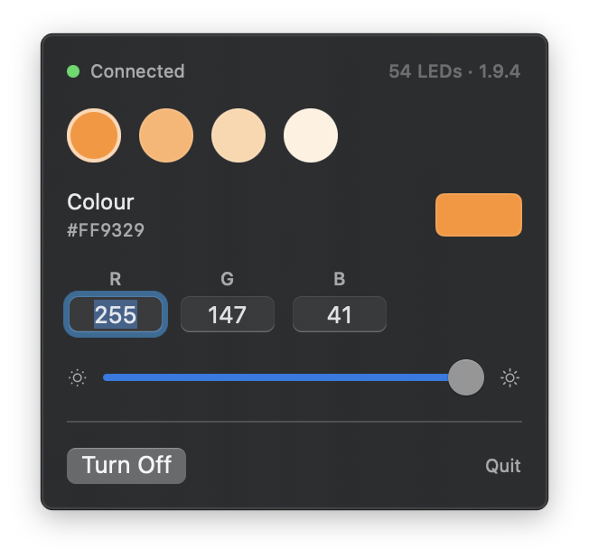

# OpenLamp — a native macOS app for the Robobloq monitor light strip



[](#requirements)
[](LICENSE)

A menu bar app that keeps a static colour on the Robobloq USB light strip, with brightness and off, in a single process that costs a fraction of what the vendor app costs. It replaces SyncLight's static-colour job and is a lighter alternative to OpenRGB on macOS. It is not a reimplementation of SyncLight's full feature set. It exists because the light should not need an Electron stack to stay on.

If you are looking for a SyncLight alternative on macOS — a way to keep a Robobloq strip lit without Electron — this is that project.

Status: v1 is implemented and has been tested against the strip. Static colour only.



*The menu bar popover: presets, editable RGB, brightness and off.*

## Why this exists

The Robobloq strip ships with **SyncLight**, an Electron app. Measured on a test Mac:

| | SyncLight | OpenRGB | OpenLamp (measured) |
|---|---|---|---|
| Memory | ~230 MB, 5 processes | 137–165 MB | 16 MB physical footprint at idle, 1 process |
| Idle CPU | ~3.4% | — | 0.0–0.1% |
| Persistence | stays open and re-sends colour | profile keyed to a HID ID that changes per connect | re-sends colour on device arrival |

OpenLamp's numbers are `footprint` physical footprint at idle (peak 17 MB), not RSS. Reproduce with `footprint -p $(pgrep -x OpenLamp)`.

SyncLight works. It handles a strip with no onboard memory by staying open and re-sending state. But it does that with five processes, a GPU renderer, and a repeating wakeup.

OpenRGB is lighter than SyncLight but still heavy, and its model does not fit this device. It stores colour in a profile keyed to the HID location ID, which changes on every connection. Loading the profile succeeds, matches nothing, and silently applies nothing.

OpenLamp takes the one part that matters — hold the HID device open and re-send the current colour — and removes the rest. The wire protocol is derived from OpenRGB's published Robobloq controller, so the USB work does not need repeating.

## What it does

- Static colour for the whole strip.
- Four warm presets, a built-in colour picker, and editable R, G and B values.
- Brightness, remembered across launches.
- Off, without quitting the app.
- Menu bar only. No Dock icon, no window.
- Offers to start at login once on first launch.
- Re-applies colour after replug and after system wake. The HID handle is held open, so there is no profile file to fall out of sync.
- Runs on macOS 13 or later (tested on Apple silicon).

First launch is off until you choose a colour. The app then remembers the colour, brightness and on/off state.

## What it does not do

- Screen sync.
- Music sync.
- Firmware animations (breathing, rainbow, and friends).
- Windows or Linux.
- Network access, telemetry, or an updater.

Those may be added later, but they are not v1. The point of v1 is a light that costs almost nothing while it sits there.

## Hardware

```
Vendor       Robobloq
VID:PID      0x1A86:0xFE07
Transport    USB HID, IOKit, no driver install
LEDs         54
Display      24 inches
Edges        top, left, right
Wire map     RGB
Firmware     1.9.4
```

The strip has no onboard memory. If nothing keeps the HID handle open, colour does not survive a reconnect.

Only one controller can use the strip at a time. Quit SyncLight and OpenRGB before running OpenLamp or the probe.

## Install

Download `OpenLamp.app.zip` from [Releases](../../releases), unzip it, and drag `OpenLamp.app` to `/Applications`. The app is ad-hoc signed, so the first launch needs right-click → Open.

To build it yourself, see below.

## Requirements

macOS 13 or later (tested on Apple silicon), and Xcode command line tools with Swift 5.9 or later.

## Building

```sh
swift test                     # protocol and state tests
swift run probe                # read device info, light the strip warm, exit
swift run probe FFB46B 0.6     # set a colour at 60% brightness
swift run probe off            # turn the strip off

./scripts/package.sh           # build/OpenLamp.app, ad-hoc signed
./scripts/package.sh --install # build, copy to /Applications, launch
ditto -c -k --norsrc --keepParent build/OpenLamp.app build/OpenLamp-1.0.0.zip  # release asset
```

The probe fails loudly if it cannot open the strip, which is what happens when another controller already holds it.

The app is a real bundle because macOS needs one for `LSUIElement`, `MenuBarExtra` and `SMAppService`. The packaging script copies the release binary into `OpenLamp.app`, writes `Support/Info.plist`, and ad-hoc signs the result. No Homebrew and no helper processes.

## Layout

```
Sources/OpenLampKit/Protocol.swift    packet framing, checksum, command builders
Sources/OpenLampKit/Transport.swift   IOKit HID matching, open, write, input reports
Sources/OpenLampKit/DeviceActor.swift serial owner of the strip and re-apply logic
Sources/OpenLampKit/State.swift       colour and brightness, persisted in UserDefaults
Sources/OpenLamp/                     SwiftUI menu bar app
Sources/probe/                        CLI bring-up tool
Support/Info.plist                    bundle metadata, LSUIElement and minimum macOS
Support/AppIcon.icns                  app icon (source: Support/AppIcon.png)
scripts/package.sh                    assemble and ad-hoc sign OpenLamp.app
```

## Protocol and licence

The packet format, checksum and command bytes come from OpenRGB's `RobobloqLightStripController`, which is **GPL-2.0-or-later**. OpenLamp is therefore GPL-2.0-or-later as well, and credits OpenRGB for that work. See `LICENSE`.

Reference: <https://gitlab.com/CalcProgrammer1/OpenRGB>

## Name and disclaimer

`OpenLamp` is a working name. It is not affiliated with Robobloq, SyncLight, or OpenRGB. It is unrelated to the OpenLamp stage-lighting project; this repository is only the macOS Robobloq light-strip controller.
